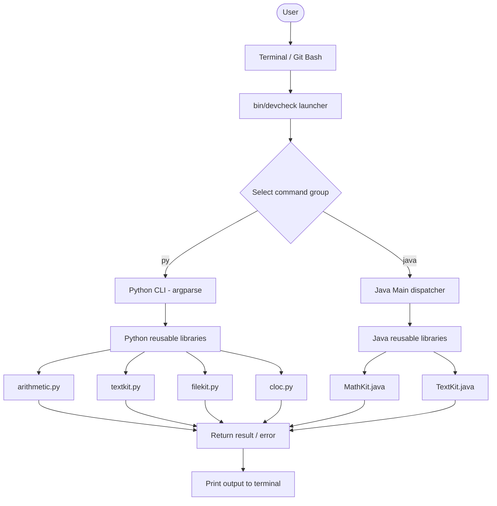
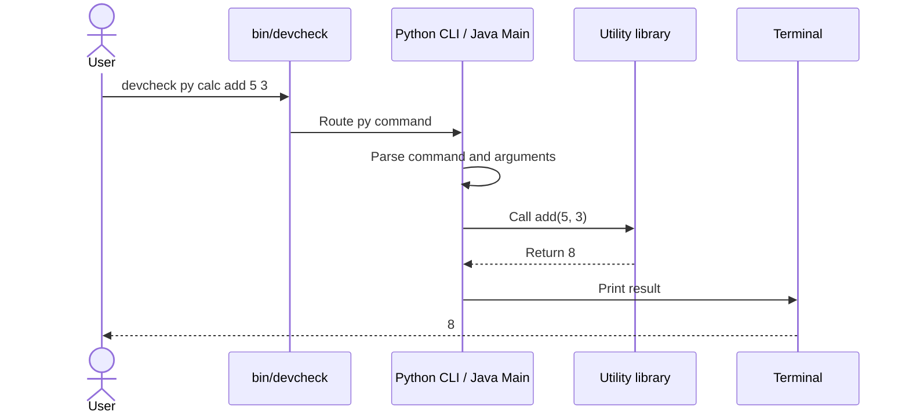
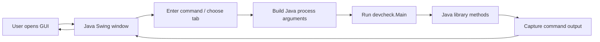
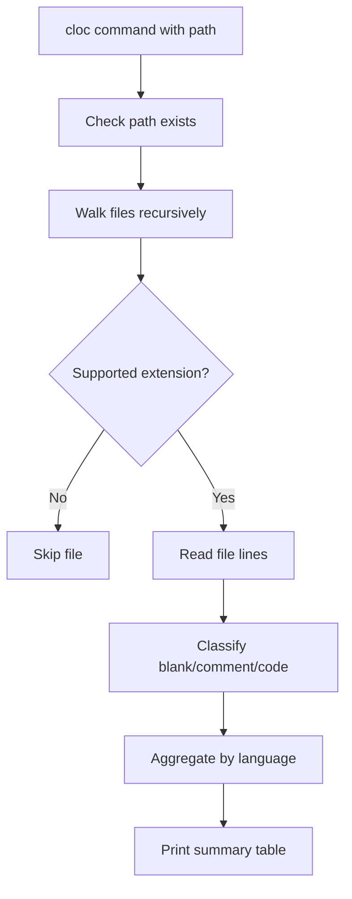

# DevCheck CLI — Project Report

> **DevCheck CLI** is an educational Python + Java command-line toolbox with reusable libraries for arithmetic, text processing, file inspection, and CLOC-like source-code statistics. It also includes two Java Swing GUI entry points.

## Project details

| Field | Details |
|---|---|
| Project / Tool | DevCheck CLI |
| Member 01 | Sandesh Pate |
| Roll No. | 25 |
| Member 02 | Harshal Dama |
| Roll No. | 59 |
| Date | 27-10-2026 |
| Repository | Add your GitHub URL after pushing |

## Contents

- [Project overview](#project-overview)
- [Features](#features)
- [Project folder structure](#project-folder-structure)
- [Architecture and working flow](#architecture-and-working-flow)
- [Requirements](#requirements)
- [Installation and setup](#installation-and-setup)
- [Command reference](#command-reference)
- [GUI applications](#gui-applications)
- [CLOC-like scanner](#cloc-like-scanner)
- [Testing](#testing)
- [Demo walkthrough](#demo-walkthrough)
- [Limitations and scope](#limitations-and-scope)
- [References](#references)

## Project overview

DevCheck CLI brings selected developer and coursework operations into one project-owned launcher. Users can choose the Python or Java command group, pass a command and its arguments, and receive a result in the terminal. The project is designed to demonstrate command dispatch, argument validation, reusable libraries, file-system inspection, GUI integration, and testing.

### Problem statement

Small tasks such as calculations, text transformations, checking file metadata, hashing files, and counting source-code lines are often done using separate shell commands or short scripts. DevCheck provides a compact educational interface to selected operations and shows how command-line programs can call reusable library functions.

### Main features

- Python command group with `argparse`.
- Java command dispatcher with reusable `MathKit` and `TextKit` classes.
- Arithmetic, statistics, text operations, file metadata, tree listing, and SHA-256 hashing.
- CLOC-like source scanner for supported file extensions.
- Educational `mathx` operations including vectors, numerical integration, and linear-regression prediction.
- Two Java Swing GUI applications.
- Python unit tests and Java smoke tests.

> **Scope note:** The `cloc` command is an educational CLOC-like source scanner. It reports supported language file counts and blank/comment/code line counts. It is not a JSON directory-auditing tool and does not claim to replace official `cloc`.

## Features

| Feature | Description |
|---|---|
| Python CLI | Parses and dispatches commands through `argparse` |
| Java CLI | Routes commands through `devcheck.Main` |
| Math libraries | Basic arithmetic, statistics, factorial, vectors, integration, regression prediction |
| Text libraries | Reverse, palindrome, count, upper/lower case |
| File helpers | File information, directory tree listing, SHA-256 |
| CLOC-like scanner | Counts files and line categories for supported languages |
| GUI | Java Swing command console, web editor/preview, and document editor |
| Tests | Python `unittest` suite and Java smoke script |

## Project folder structure

The following structure is based on the supplied `DevCheck-CLI` project archive. Some generated files, such as `.class` files and `__pycache__`, are intentionally omitted from this tree.

```text
DevCheck-CLI/
├── README.md
├── REPORT-TEMPLATE.md
├── CHANGELOG-ENHANCED.md
├── Makefile
├── .flake8
├── .gitignore
├── bin/
│   └── devcheck                 # Main launcher
├── devcheck                     # Root-level launcher
├── docs/
│   ├── COMMANDS.md              # Command reference
│   └── RUN-GUIDE.md             # Setup and run guide
├── python/
│   ├── pyproject.toml
│   ├── requirements-dev.txt
│   ├── devcheck_cli/
│   │   ├── __init__.py
│   │   └── cli.py               # Python CLI / argument parser
│   ├── devcheck_libs/
│   │   ├── __init__.py
│   │   ├── arithmetic.py         # Arithmetic, stats, mathx
│   │   ├── textkit.py           # Text helper functions
│   │   ├── filekit.py            # Read-only file helpers
│   │   └── cloc.py               # CLOC-like source scanner
│   └── tests/
│       └── test_libraries.py      # Python unit tests
├── java/
│   ├── src/
│   │   └── devcheck/
│   │       ├── Main.java         # Java CLI dispatcher
│   │       ├── DevCheckGui.java  # Developer Studio GUI
│   │       ├── DevCheckGui1.java # Simple Java command GUI
│   │       └── lib/
│   │           ├── MathKit.java
│   │           └── TextKit.java
│   └── build/                    # Compiled Java classes (generated)
│       └── devcheck/
├── tests/
│   └── java-smoke.sh             # Java smoke tests
└── [other generated files]
```

## Architecture and working flow

### High-level architecture



### Command execution flow



### GUI working flow



### Components

| Component | Responsibility | File |
|---|---|---|
| Launcher | Routes Python/Java group and starts command | `bin/devcheck` |
| Python CLI | Parses commands and calls functions | `python/devcheck_cli/cli.py` |
| Arithmetic | Arithmetic, statistics, math helpers | `python/devcheck_libs/arithmetic.py` |
| Text | Reverse, palindrome, counts | `python/devcheck_libs/textkit.py` |
| File helpers | Metadata, listing, SHA-256 | `python/devcheck_libs/filekit.py` |
| Scanner | Source file and line-category counts | `python/devcheck_libs/cloc.py` |
| Java dispatcher | Java command routing | `java/src/devcheck/Main.java` |
| Java math library | Math helper methods | `java/src/devcheck/lib/MathKit.java` |
| Java text library | Text helper methods | `java/src/devcheck/lib/TextKit.java` |
| GUI 1 | CLI console, web editor, document editor | `java/src/devcheck/DevCheckGui.java` |
| GUI 2 | Simple Java command console | `java/src/devcheck/DevCheckGui1.java` |
| Tests | Python and Java checks | `python/tests/`, `tests/java-smoke.sh` |

## Requirements

| Requirement | Details |
|---|---|
| Operating system | Windows with Git Bash, Linux, or compatible shell |
| Python | Python 3.10+ |
| Java | JDK with `java` and `javac` |
| Shell | Git Bash recommended for `./bin/devcheck` and `.sh` scripts |
| Network | Not required to run the commands after setup |

## Installation and setup

### Step 1 — Extract and open the project

Extract the ZIP archive and open the `DevCheck-CLI` folder in VS Code.

In Git Bash, navigate to the project directory. Replace the path below with the actual location:

```bash
cd "/d/ITM PYTHON/Linux/Final_CLI_linux_project/DevCheck-CLI"
```

### Step 2 — Check prerequisites

Run each command:

```bash
python --version
java -version
javac -version
```

Python must be 3.10 or newer. Java commands and GUI applications require a JDK.

### Step 3 — Install Python package

```bash
python -m pip install -e ./python
```

This installs the project in editable mode in the active Python environment.

### Step 4 — Run a first command

```bash
./bin/devcheck py calc add 5 3
```

Expected result:

```text
8
```

### Step 5 — Check help

```bash
./bin/devcheck py --help
./bin/devcheck java help
```

> Run commands from the project root in Git Bash. If your project folder is elsewhere, use its actual path.

## Command reference

### General syntax

```text
./bin/devcheck <py|java> <command> [arguments]
```

### Python commands

| Command | Syntax | Example | Purpose |
|---|---|---|---|
| `calc` | `calc <operation> <a> <b>` | `./bin/devcheck py calc add 5 3` | Basic arithmetic |
| `stats` | `stats <number>...` | `./bin/devcheck py stats 10 20 30` | Count, mean, median, min, max, sum |
| `reverse` | `reverse <text>...` | `./bin/devcheck py reverse hello world` | Reverse text |
| `palindrome` | `palindrome <text>...` | `./bin/devcheck py palindrome level` | Check palindrome |
| `count` | `count <text>...` | `./bin/devcheck py count hello world` | Character and word counts |
| `upper` | `upper <text>...` | `./bin/devcheck py upper hello` | Convert to uppercase |
| `lower` | `lower <text>...` | `./bin/devcheck py lower HELLO` | Convert to lowercase |
| `fileinfo` | `fileinfo <path>` | `./bin/devcheck py fileinfo README.md` | File size and line count |
| `tree` | `tree [path]` | `./bin/devcheck py tree .` | List files to limited depth |
| `hash` | `hash <path>` | `./bin/devcheck py hash README.md` | SHA-256 hash |
| `cloc` | `cloc [path]` | `./bin/devcheck py cloc .` | Source-code statistics |
| `mathx` | `mathx <operation> <values...>` | `./bin/devcheck py mathx factorial 5` | Advanced educational math |

### Python `calc` operations

```bash
./bin/devcheck py calc add 5 3
./bin/devcheck py calc subtract 5 3
./bin/devcheck py calc multiply 5 3
./bin/devcheck py calc divide 6 3
./bin/devcheck py calc power 2 3
```

### Python `mathx` operations

| Operation | Example |
|---|---|
| Modulus | `./bin/devcheck py mathx mod 10 3` |
| Factorial | `./bin/devcheck py mathx factorial 5` |
| Numerical integration of x² | `./bin/devcheck py mathx integrate-x2 0 3` |
| Vector addition | `./bin/devcheck py mathx vector-add 1,2,3 4,5,6` |
| Vector dot product | `./bin/devcheck py mathx vector-dot 1,2,3 4,5,6` |
| Linear-regression prediction | `./bin/devcheck py mathx ml-predict 1,2,3 2,4,6 4` |

For vector inputs, keep each comma-separated vector as one argument and do not put spaces inside it.

### Java commands

| Command | Syntax | Example | Purpose |
|---|---|---|---|
| `greet` | `greet <name>` | `./bin/devcheck java greet Sandesh` | Print greeting |
| `calc` | `calc <operation> <a> <b>` | `./bin/devcheck java calc add 2 3` | Arithmetic |
| `reverse` | `reverse <text>...` | `./bin/devcheck java reverse hello world` | Reverse text |
| `palindrome` | `palindrome <text>...` | `./bin/devcheck java palindrome level` | Check palindrome |
| `count` | `count <text>...` | `./bin/devcheck java count hello world` | Count words/characters |
| `upper` | `upper <text>...` | `./bin/devcheck java upper hello` | Uppercase |
| `lower` | `lower <text>...` | `./bin/devcheck java lower HELLO` | Lowercase |
| `stats` | `stats <number>...` | `./bin/devcheck java stats 10 20 30` | Basic statistics |
| `fileinfo` | `fileinfo <path>` | `./bin/devcheck java fileinfo README.md` | File details |
| `mathx` | `mathx <operation> <values...>` | `./bin/devcheck java mathx factorial 5` | Math helpers |
| `cloc` | `cloc [path]` | `./bin/devcheck java cloc .` | Source statistics |
| `help` | `help` | `./bin/devcheck java help` | Display help |

### Command examples and expected results

```bash
./bin/devcheck py calc add 5 3
# 8

./bin/devcheck py reverse "DevCheck CLI"
# ILC kceveD

./bin/devcheck py mathx vector-add 1,2,3 4,5,6
# [5.0, 7.0, 9.0]

./bin/devcheck java greet Sandesh
# Hello, Sandesh!

./bin/devcheck java calc multiply 6 7
# 42.0
```

Expected results above are deterministic examples; capture actual terminal output for submission evidence.

## GUI applications

The project includes two Java Swing GUI entry points.

### GUI 1 — DevCheck Developer Studio

Run from the repository root:

```bash
java -cp java/build devcheck.DevCheckGui
```

The window has three tabs:

| Tab | Purpose |
|---|---|
| CLI Console | Enter a Java command, run it, and view output; includes Help |
| Web Studio | Edit HTML, CSS, and JavaScript; refresh preview; save HTML |
| Document Editor | Rich text editing controls such as bold, italic, heading, font size, alignment, open/save, and template |

### GUI 2 — DevCheck CLI Java Toolbox

Run:

```bash
java -cp java/build devcheck.DevCheckGui1
```

This GUI provides a command input field, **Run Java command**, **Show help**, and an output area. Example commands include:

```text
greet Sandesh
calc add 5 3
reverse hello world
palindrome Never odd or even
stats 10 20 30
```

### GUI run steps

1. Open Git Bash in the project root.
2. Ensure the Java classes exist in `java/build`. If not, compile them using the launcher or compile the Java source.
3. Run one of the GUI commands above.
4. Enter a Java command in the command field.
5. Click **Run** / **Run Java command** or press Enter.
6. Read the command output in the GUI.

If the GUI cannot start, check `java -version`, `javac -version`, and confirm `java/build` contains compiled classes. GUI windows require a desktop environment.

## CLOC-like scanner

Run:

```bash
./bin/devcheck py cloc .
```

Or scan a specific folder:

```bash
./bin/devcheck py cloc ./python
./bin/devcheck java cloc .
```

The scanner reports per language:

- Files
- Blank lines
- Comment lines
- Code lines

It supports extensions including Python, Java, JavaScript, TypeScript, HTML, CSS, C/C++, C#, Go, Ruby, PHP, Shell, SQL, and Markdown. Common generated/dependency directories such as `.git`, `.venv`, `venv`, `node_modules`, `__pycache__`, `build`, and `dist` are skipped.

### Scanner flow



> Counts are educational approximations. Comment parsing is not a full parser for every supported language, and inline comments or complex block-comment syntax may not be classified perfectly.

## Testing

### Python unit tests

```bash
python -m unittest discover -s python/tests -v
```

### Java smoke tests

```bash
bash tests/java-smoke.sh
```

The project run guide indicates the Java smoke script should finish with:

```text
Java smoke tests passed (3 checks).
```

### Makefile targets

| Target | Command | Purpose |
|---|---|---|
| `test` | `make test` | Run Python unit tests |
| `lint` | `make lint` | Run Flake8 |
| `complexity` | `make complexity` | Run Radon complexity and maintainability checks |
| `cloc` | `make cloc` | Run external `cloc` if installed |
| `java-test` | `make java-test` | Run Java smoke tests |

Optional development tools may need installation before `lint` or `complexity` targets can run.

## Demo walkthrough

Run one command at a time in Git Bash from the project root:

```bash
# 1. Arithmetic
./bin/devcheck py calc add 5 3

# 2. Text transformation
./bin/devcheck py reverse "DevCheck CLI"

# 3. Statistics
./bin/devcheck py stats 10 20 30

# 4. Educational vector operation
./bin/devcheck py mathx vector-add 1,2,3 4,5,6

# 5. File metadata and hashing
./bin/devcheck py fileinfo README.md
./bin/devcheck py hash README.md

# 6. Source-code statistics
./bin/devcheck py cloc .

# 7. Java command group
./bin/devcheck java greet Sandesh
./bin/devcheck java calc multiply 6 7

# 8. GUI
java -cp java/build devcheck.DevCheckGui1

# 9. Tests
python -m unittest discover -s python/tests -v
bash tests/java-smoke.sh
```

## Error handling and safety

| Situation | Expected behavior |
|---|---|
| Unknown command / missing arguments | Parser or help/usage error |
| Invalid numeric input | Input/parse error |
| Divide or modulus by zero | Error rather than a valid numeric result |
| Missing file | File/path error |
| Invalid directory for tree scan | Directory error |
| Unsupported source extension | Scanner skips the file |
| Java/JDK unavailable | Java commands and GUI cannot run until JDK is installed |

File helper operations are intended to be read-only: file metadata, listing, and SHA-256 do not edit or delete user files. The scanner reads source files and produces counts.

## Limitations and scope

- This is a learning-focused project, not a replacement for official `cloc`, GNU Coreutils, or mature CLI frameworks.
- The scanner uses simple line-based comment classification and is not a complete language parser.
- The project does not provide AI command generation, arbitrary shell execution, a database, or a network service.
- GUI applications are Java Swing desktop programs and require a working graphical environment.
- Verify exact command behavior and test results in your own environment before submitting.

## References

- [Python argparse](https://docs.python.org/3/library/argparse.html) — CLI argument parsing.
- [Python unittest](https://docs.python.org/3/library/unittest.html) — unit testing.
- [Python Packaging User Guide](https://packaging.python.org/en/latest/) — Python project packaging.
- [Java documentation](https://docs.oracle.com/en/java/) — Java language and standard library.
- [GNU Coreutils](https://www.gnu.org/software/coreutils/) — established shell utilities.
- [Official cloc](https://github.com/AlDanial/cloc) — source-code counting tool.
- [Shelldon](https://github.com/thejunghare/shelldon) — terminal assistant reference, distinct from DevCheck's fixed command set.

## Submission checklist

- [ ] Replace the repository placeholder with the actual GitHub URL.
- [ ] Confirm the README folder tree matches the final repository.
- [ ] Run the Python tests and Java smoke tests; paste actual output if required.
- [ ] Run the demo commands and capture terminal screenshots.
- [ ] Verify GUI applications launch on the submission machine.
- [ ] Commit and push the README and report files.
- [ ] Submit the GitHub repository URL.
