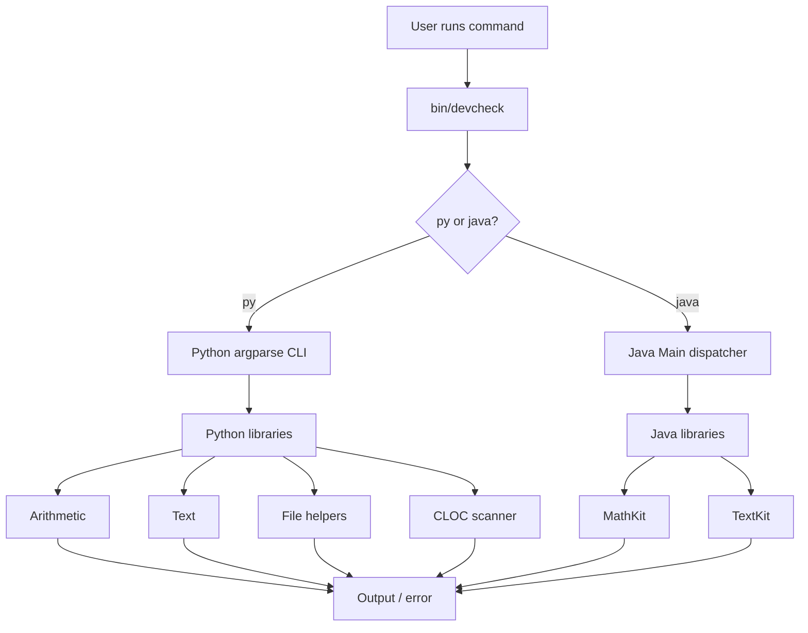

# DevCheck CLI — Assignment Report / Evidence Template

# DevCheck CLI — Project Report

**Tool:** DevCheck CLI  
**Project:** DevCheck CLI  
**Member 01:** Sandesh Pate
**ROLL NO:** 25 
**Member 01:** Harshal  Dama
**ROLL NO:** 59      
**Date:** 27-10-2026  
**Repository:** Add the GitHub URL after pushing the project.

> This report is structured to match the assignment prompt. Replace all evidence placeholders with genuine results from your own machine. Never invent shell-history counts, prior-art trials, classmate feedback, or test output.

## 1. The problem

### What I keep doing by hand

Describe a recurring task from your own workflow: calculations, text transformations, file checks, Java runs, or source-code statistics.

```bash
# Add the exact commands you personally used before DevCheck.
```

### Evidence that this is real

Run in Git Bash:

```bash
history | grep -E 'python|javac|java|find|wc|cloc' | wc -l
history | grep -E 'python|javac|java|find|wc|cloc' | tail -10
```

**Actual output:**

```text
Paste your own terminal output here.
```

**Frequency and cost:** In two sentences, state how often you perform these tasks and the time they take.

### Who else has this problem

Record an actual classmate's name/role (if permitted) and their response. If you did not ask anyone, say so.

## 2. Prior art — what already exists

| Tool | Source | What it does | Why it does not fully meet this project's educational scope |
|---|---|---|---|
| GNU Coreutils (`wc`, `find`) | https://www.gnu.org/software/coreutils/ | File and text operations | Separate tools; not the project's custom Python/Java library exercise |
| Official `cloc` | https://github.com/AlDanial/cloc | Source code statistics | Mature dedicated utility; DevCheck scanner is a small educational implementation |
| Python `argparse` | https://docs.python.org/3/library/argparse.html | CLI argument parsing | Parser component, not a complete custom command toolbox |
| Apache Commons CLI | https://commons.apache.org/proper/commons-cli/ | Java CLI parsing | Additional Java dependency; DevCheck uses a lightweight dispatcher |
| Shelldon | https://github.com/thejunghare/shelldon | AI terminal suggestions and explanations | Different project scope; not a deterministic Python/Java command toolkit |

### Tools found and actually tried

For at least three tools, enter exact commands and real output. A website link alone is not evidence.

| Tool | Command run | Actual result | What was missing |
|---|---|---|---|
| Tool 1 | | | |
| Tool 2 | | | |
| Tool 3 | | | |

### Evidence of trying them

```bash
# Exact command
```

```text
# Actual output copied from terminal
```

### Where we searched

- [ ] GitHub search
- [ ] Stack Overflow
- [ ] PyPI
- [ ] `man -k <keyword>` (where available)
- [ ] Asked a human: who and what they said
- [ ] Other: 

### The gap, in one sentence

Existing tools can perform individual file, text, calculation, and source-counting tasks, but DevCheck packages a small set of project-owned Python and Java commands with reusable libraries in one educational CLI.

## 3. What we are building

### In scope

- One `devcheck` launcher with `py` and `java` groups.
- Calculation, text, file, and statistics commands.
- Reusable Python and Java libraries.
- A CLOC-like scanner for supported file extensions.
- Tests and installation instructions.

### Out of scope

- AI-generated shell commands.
- Arbitrary command execution.
- Replacing official `cloc` or mature CLI tools.
- Modifying/deleting user files.

### Success measure

The documented command paths work, tests pass, and a new user can install and run the tool using the guide.

## 4. Tech stack

| Choice | Selected | Why / alternative |
|---|---|---|
| Language | Python + Java | Coursework and reusable libraries; Java demonstrates package/classes |
| CLI parser | argparse + Java dispatcher | Built in, no third-party parser |
| Dependencies | Standard libraries | Offline and reproducible |
| Tests | unittest + Java smoke shell | Lightweight |
| Packaging | Editable pip install + launcher | Easy local install |

### Why these languages

Write your own honest explanation, including familiarity and assignment requirements.

### Deliberately not used

Explain why Bash-only or a third-party framework was not selected.

## 5. Architecture



### Components

| Part | Responsibility | File |
|---|---|---|
| Launcher | Route command group, compile/run Java | `bin/devcheck` |
| Python CLI | Parse commands and call libraries | `python/devcheck_cli/cli.py` |
| Arithmetic | Arithmetic, statistics, vector and regression helpers | `python/devcheck_libs/arithmetic.py` |
| Text | Reverse, palindrome, counts | `python/devcheck_libs/textkit.py` |
| File helpers | File info, tree, SHA-256 | `python/devcheck_libs/filekit.py` |
| CLOC-like scanner | File/code/comment/blank counts | `python/devcheck_libs/cloc.py` |
| Java CLI | Java command dispatcher | `java/src/devcheck/Main.java` |
| Java libraries | Math and text helpers | `java/src/devcheck/lib/MathKit.java`, `TextKit.java` |

### Data flow

Explain what input comes from the user, how the launcher selects a command group, which library processes it, and what output is produced.

### Failure cases

| Failure | Response |
|---|---|
| Invalid command/argument | Usage/help or error |
| Invalid number / divide by zero | Error |
| Missing file | Clear file error |
| Java/Javac missing | Requirement/error message |

## 6. Usage and Demonstration

### 6.1 Project Overview

DevCheck CLI is a command-line utility developed using Java, Python, and Bash. It provides custom commands for common development tasks. The Bash launcher allows users to invoke supported Java commands through a simple command interface.

The project includes a Java command handler, a Python filesystem scanner, and a CLOC-like source-code analysis feature.

### 6.2 Technologies Used

- **Java:** Implements custom commands and command processing.
- **Python:** Performs filesystem scanning and project analysis.
- **Bash / Git Bash:** Provides the custom `devcheck` command launcher.
- **Git:** Used for version control and project management.

### 6.3 Custom Command Setup

The `devcheck` Bash script is located in the project root directory.

Make the script executable:

```bash
chmod +x devcheck
```

Add the current project directory to the `PATH` for the current Git Bash session:

```bash
export PATH="$PWD:$PATH"
```

After this setup, the custom command can be invoked directly without typing `./` before the script name.

**Note:** The `PATH` change above is temporary and applies to the current Git Bash session.

### 6.4 Help Command

**Command:**

```bash
./devcheck help
```

**Actual terminal output:**

```text
DevCheck CLI - Custom Commands
Usage:
  devcheck help
  devcheck greet NAME
  devcheck calc add NUMBER NUMBER
  devcheck scan [PATH]
  devcheck cloc [PATH]
```

The help command displays the currently documented commands and their expected arguments.

### 6.5 Running the Custom Command

**Commands:**

```bash
export PATH="$PWD:$PATH"

devcheck help
devcheck greet Sandesh
devcheck calc add 5 3
```

**Actual terminal output:**

```text
DevCheck CLI - Custom Commands
Usage:
  devcheck help
  devcheck greet NAME
  devcheck calc add NUMBER NUMBER
  devcheck scan [PATH]
  devcheck cloc [PATH]
Hello, Sandesh!
8.0
```

The output demonstrates that the custom launcher successfully invokes the Java command handler for the greeting and addition commands.

### 6.6 Text Reversal Command

**Command:**

```bash
devcheck reverse hello world
```

**Actual terminal output:**

```text
dlrow olleh
```

The reverse command reverses the supplied text.

### 6.7 Command Reference

| Command | Purpose | Verification status |
|---|---|---|
| `devcheck help` | Display available commands | Tested |
| `devcheck greet Sandesh` | Display a greeting | Tested |
| `devcheck calc add 5 3` | Add two numbers | Tested |
| `devcheck reverse hello world` | Reverse text | Tested |
| `devcheck scan .` | Scan project files | Pending verification |
| `devcheck cloc .` | Generate source-code statistics | Pending verification |

### 6.8 Additional Commands to Test

Run the following commands and record their actual outputs before marking them as tested.

**Filesystem scan:**

```bash
devcheck scan .
```

**CLOC report:**

```bash
devcheck cloc .
```

**Palindrome check:**

```bash
devcheck palindrome Never odd or even
```

**Statistics:**

```bash
devcheck stats 10 20 30
```

The scanner and CLOC commands must be verified against the project's actual Python scanner and CLOC implementation. Their successful operation should not be assumed until the terminal output confirms it.

### 6.9 Conclusion

The initial demonstration confirms that the custom Bash launcher can display help and execute the tested Java greeting, addition, and text-reversal commands from Git Bash.

Further testing is required to verify filesystem scanning, CLOC integration, error handling, and the remaining documented commands. These tests will help establish that the project meets its functional requirements.
